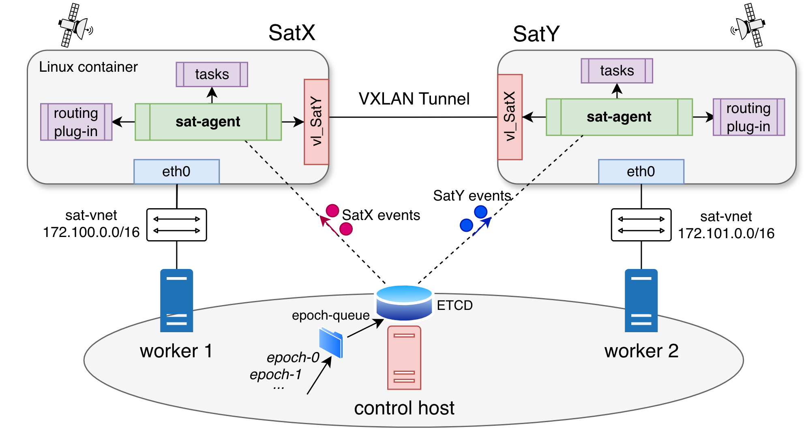

<div align="center">


# NetSatBench

### Distributed LEO Constellation Emulation


</div>

NetSatBench is a distributed emulation platform for evaluating communication protocols and application workloads over large-scale LEO satellite systems.

Satellites, gateways, and user terminals are emulated as Linux containers distributed across worker hosts. Emulated links are realized through a VXLAN-based Layer-2 overlay. Time-varying system dynamics are driven by JSON epoch files and coordinated through Etcd.

NetSatBench offers a declarative JSON + command-line workflow, while keeping routing and physical-layer modeling extensible through plug-ins.

## Table of Contents

- [Core Features](#core-features)
- [Architecture Overview](#architecture-overview)
- [Emulation Model](#emulation-model)
- [Repository Structure](#repository-structure)
- [Requirements](#requirements)
- [Quick Start](#quick-start)
- [Example Interaction](#example-interaction)
- [Cleanup](#cleanup)
- [Documentation](#documentation)
- [Reference](#reference)

---

## Core Features

- Distributed container-based emulation of large constellations
- VXLAN Layer-2 overlay for inter-satellite (ISL) and satellite-to-ground links
- Epoch-driven topology and task updates through Etcd and JSON files
- Declarative scenario definition with JSON files
- Plug-in interfaces for routing and physical-layer models
- Built-in IPv4 and IPv6 auto-assignment
- Built-in routing plug-ins, including IS-IS (IPv4/IPv6) and oracle routing
- Built-in physical-layer plug-ins, including StarPerf-based ISL models and simple parametric models for satellite-to-ground links
- Unified operational CLI (`nsb.py`) for init, deploy, run, monitor, and data transfer

---

## Architecture Overview

<div align="center">

</div>

The **control plane** has three components:

| Component | Role |
|-----------|------|
| `Etcd` | Global emulation state store |
| `sat-agent` | Runs inside each node container, subscribes to node-relevant state and applies local changes (link setup, traffic control, task execution) |
| Control host | Runs `nsb.py` to initialize, deploy, run, and monitor experiments |

The **data plane** is a distributed Layer-2 VXLAN overlay among containers. Link characteristics (delay, rate, loss) are enforced with Linux traffic control.

---

## Emulation Model

Execution is organized into epochs. Each epoch file describes:

- The epoch start time
- Link additions, updates, and deletions
- Commands to run on selected nodes

`nsb.py run` pushes these updates into Etcd, and only the affected `sat-agent`s react to each change.

Supported execution styles:

- **Discrete-time replay** of pre-generated epoch files (repeatable experiments)
- **Real-time injection** via an epoch queue (digital-twin style)

---

## Repository Structure

| Path | Content |
|------|---------|
| `control/` | Orchestration and runtime control logic |
| `sat-container/` | Container image and `sat-agent` code |
| `generators/` | Scenario and epoch generation tools |
| `examples/` | Sample scenarios and configurations |
| `utils/` | Utility scripts |
| `docs/` | Command and configuration documentation |
| `test/` | Experiments using NetSatBench |

---

## Requirements

### Etcd

- An Etcd instance with a stable network connection
- Etcd API reachable from the control host and all worker hosts

### Control Host

- Linux host with key-based SSH access to all workers
- Python 3 and the dependencies in `requirements.txt`

### Worker Hosts

- Linux hosts with Docker
- SSH server enabled
- SSH user with passwordless `sudo` (required by setup/cleanup operations)
- SSH user in the `docker` group

### Network Prerequisite

The underlay network must allow direct connectivity (no NAT) among the container subnets used for VXLAN endpoints. **No anti-spoofing rule may block container-source traffic.**

---

## Quick Start

This guide assumes the Control Host and Worker Hosts are Ubuntu 24.04 virtual machines in a cloud cluster connected by the same virtual network, with Etcd running on the Control Host. It also assumes:

- Hosts have `sudo` access without a password prompt.
- Hosts run no background update process that resets the network state. On Ubuntu 24.04, disable unattended upgrades:

  ```bash
  sudo apt remove --purge unattended-upgrades
  ```

- Worker Hosts allow traffic whose source address belongs to the container subnets used for VXLAN endpoints, whose supernet is `sat-vnet-super-cidr` (default `172.20.0.0/16`). In cloud environments this may require a security change, see [Cloud Deployment Notes](docs/cloud-notes.md).
- The Control Host has public-key SSH access to all Worker Hosts.
- The Control Host runs an Etcd instance reachable from the Worker Hosts (see step 1).

> **Alternative configuration:** the Control Host is outside the cluster (e.g., your laptop) and Etcd runs on a cloud Worker Host with a public IP address. Notes for this setup are marked *Alternative config* below.

### 1. Install and configure Etcd

On Ubuntu 24.04, on the Control Host:

```bash
sudo apt update
sudo apt install -y etcd-server etcd-client
```

To allow non-local access from Worker Hosts, add the following lines to `/etc/default/etcd`, replacing `<etcd-local-host-ip>` with the IP address reachable from the Worker Hosts (here, the Control Host's IP address or the IP address of the Etcd Worker Host for the alternative configuration):

```bash
# Listen on all interfaces
ETCD_LISTEN_CLIENT_URLS="http://0.0.0.0:2379"
ETCD_LISTEN_PEER_URLS="http://0.0.0.0:2380"

# Must be a concrete, reachable address, not 0.0.0.0
ETCD_ADVERTISE_CLIENT_URLS="http://<etcd-local-host-ip>:2379"
ETCD_INITIAL_ADVERTISE_PEER_URLS="http://<etcd-local-host-ip>:2380"
ETCD_INITIAL_CLUSTER="default=http://<etcd-local-host-ip>:2380"
ETCD_INITIAL_CLUSTER_STATE="new"

# Only if you need the legacy v2 API (etcd2 behaviour)
ETCD_ENABLE_V2="true"
```

Then restart Etcd:

```bash
sudo systemctl restart etcd
```

### 2. Clone and prepare NetSatBench

On the Control Host:

```bash
git clone https://github.com/mSvcBench/NetSatBench.git
cd NetSatBench
# import StarPerf and other dependencies
git submodule update --init --recursive
# prepare the Python environment
python3 -m venv venv
source venv/bin/activate
python3 -m pip install -r requirements.txt
```

### 3. Set the Etcd environment

On the Control Host, point NetSatBench to the Etcd instance:

```bash
# Etcd address reachable from the control host (here: the Control Host's own IP)
export ETCD_HOST="<etcd-local-host-ip>"
export ETCD_PORT="2379"
# Etcd address reachable from the worker nodes
export NODE_ETCD_HOST="<etcd-local-host-ip>"
```

Optional, if authentication/TLS is enabled:

```bash
export ETCD_USER="username"
export ETCD_PASSWORD="password"
export ETCD_CA_CERT="/path/to/ca.crt"
```

> *Alternative config:* set `ETCD_HOST` to the **public** IP of the worker host running Etcd and `NODE_ETCD_HOST` to its **private** IP, so Etcd is reachable both from the Control Host outside the cluster and from the Worker Hosts inside it. Remember to open port 2379 on that worker host to the Control Host. This could require a security change in cloud environments.

### 4. Edit the worker configuration

Edit `examples/10nodes/workers-config.json`: set the worker IPs, the SSH user/key the Control Host uses to access the Worker Hosts, and the worker resource/network fields.

> *Alternative config:* configure the SSH config file of the Control Host (e.g., `~/.ssh/config`) with **ProxyJump** towards the private IP addresses of the worker hosts, through the worker with the public IP. The Control Host can then reach every worker using the IP addresses listed in `workers-config.json`.

### 5. Initialize the worker environment

From the Control Host, configure the Docker network and the routing/firewalling of each worker. The related information is stored in Etcd for use by the `sat-agent`s and the Control Host.

```bash
python3 ./nsb.py system-init-docker --config ./examples/10nodes/workers-config.json
```

### 6. Initialize the scenario state

```bash
python3 ./nsb.py init --config ./examples/10nodes/sat-config.json
```

This validates the scenario inputs, assigns resources/IPs (if auto-assignment is enabled), schedules nodes on workers, and writes the configuration into Etcd.

### 7. Deploy the node containers

```bash
python3 ./nsb.py deploy -t 8
```

This creates and starts the containers representing satellites, users, and ground stations on the worker hosts. Each container runs a `sat-agent` that subscribes to Etcd for node-relevant state.

### 8. Run the epoch-driven emulation

```bash
python3 ./nsb.py run
```

This reads the epoch files and pushes updates into Etcd. Each `sat-agent` reacts to changes relevant to its node, updating links and executing commands.

---

## Example Interaction

Run commands on nodes:

```bash
# Open a shell on node usr1
python3 ./nsb.py exec -it usr1 bash
# Show the routing table of usr1
python3 ./nsb.py exec usr1 ip route show
# Run a 30 s iperf3 test from usr1 to grd1, reporting every 2 s
python3 ./nsb.py exec usr1 iperf3 -c grd1 -t 30 -i 2
```

Upload files:

```bash
# Upload a local directory to usr1:/app
python3 ./nsb.py cp mydir/ usr1:/app
# Upload a local directory to all nodes of type "user"
python3 ./nsb.py cptype mydir/ user:/app
```

See all commands in the [CLI documentation](docs/control-commands.md).

---

## Cleanup

Remove the emulated nodes:

```bash
python3 ./nsb.py rm -t 8
```

Optionally, remove the worker-side setup:

```bash
python3 ./nsb.py system-cleanup-docker
```

---

## Documentation

- [CLI Emulation Control](docs/control-commands.md)
- [CLI Utilities](docs/utils.md)
- [Configuration and Epoch Files](docs/configuration.md)
- [Etcd Key-Value Store](docs/etcd.md)
- [Scenario Generation and Physical-Layer Plug-ins](docs/starperf-integration.md)
- [Routing Plug-ins](docs/routing-interface.md)
- [Cloud Deployment Notes](docs/cloud-notes.md)

---

## Reference

*NetSatBench: A Distributed LEO Constellation Emulator with an SRv6 Case Study* ([arXiv:2604.27854](https://arxiv.org/abs/2604.27854)). The code used for the paper is in [`test/handover`](test/handover).
